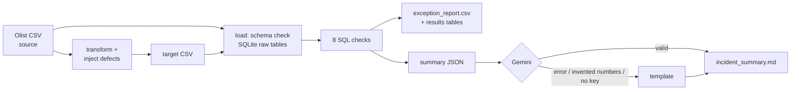

# Source-to-Target Reconciliation (DAI-042)

*Piyush Srivastava, MMMUT Gorakhpur*

This project compares a **source** payments file with a transformed **target** table, finds
every mismatch with SQL, writes an exception report, and produces an AI incident summary.
The AI answer is checked, and a template summary is used if the answer is bad.

## Files

| File | What it is |
|---|---|
| `recon.py` | The whole pipeline in about 260 lines. `# %%` marks the cells for VS Code. |
| `recon.ipynb` | The same code as a Google Colab notebook. |
| `test_recon.py` | 8 tests, 5 of them edge cases. |
| `requirements.txt` | Python packages. |
| `.gitignore` | Keeps `output/`, `data/` and `.env` out of git. |

## Run it

**Google Colab:** upload `recon.ipynb` and choose *Runtime → Run all*. To use the AI, add
`GEMINI_API_KEY` under 🔑 Secrets first. This step is optional.

**VS Code:**
```bash
pip install -r requirements.txt
python recon.py            # full run (add --no-ai to skip Gemini)
python -m pytest -v        # tests
```
To use Gemini in VS Code, set the key before running. In bash: `export GEMINI_API_KEY=...`.
On Windows: `set GEMINI_API_KEY=...`. You can also click **Run Cell** above each `# %%` to go
step by step.

## Dataset

- **Source:** `olist_order_payments_dataset.csv` from the public Kaggle
  [Brazilian E-Commerce dataset by Olist](https://www.kaggle.com/datasets/olistbr/brazilian-ecommerce).
  It has 103,886 rows and amounts are in R$. The code downloads it automatically from a public
  GitHub mirror, so no Kaggle login is needed.
- **Target:** built by `transform()`, which renames columns, upper-cases the payment type and
  rounds amounts. Then `inject_defects()` breaks it on purpose: 25 missing rows, 10 extra
  rows, 8 duplicates, 15 changed amounts, 3 null keys and 5 non-numeric amounts. Because we
  know exactly what was injected, we can prove the checks are correct.

## Pipeline



**Checks** (the key is `order_id, payment_seq`): row count, amount total, missing in target,
extra in target, duplicate key, null key, amount mismatch (more than 0.01), and invalid amount.

**SQLite tables:**
- `raw_source` and `raw_target` are replaced on every run, so a rerun never doubles the data.
- `recon_results`, `recon_exceptions` and `ai_summaries` are appended with a `run_id`, so the
  history of every run is kept.

**AI:**
- Only the small summary JSON is sent to the model, never the raw data.
- `LLMClient.complete()` is the interface, and `GeminiClient` is the implementation.
- Every number in the AI answer must appear in the report. If it doesn't, or if the call fails,
  the template summary is used. A broken AI never breaks the pipeline.

## Sample output

```
  FAIL  row_count          103,886.00 vs 103,882.00
  FAIL  amount_total       16,008,872.12 vs 16,008,639.98
  FAIL  missing_in_target  25 rows
  FAIL  extra_in_target    10 rows
  FAIL  duplicate_key      8 rows
  FAIL  null_key           3 rows
  FAIL  amount_mismatch    15 rows
  FAIL  invalid_amount     5 rows
```
All six injected defects are found with the exact counts. The run takes about 2 seconds.

## Tests

| Test | What it proves |
|---|---|
| clean data passes | no false alarms |
| every injected defect is found | exact counts for all 6 defect types |
| empty target | edge case: everything reported missing, no crash |
| missing column | edge case: clear `SchemaError` |
| rerun is idempotent | raw tables are not doubled |
| AI failure → fallback | edge case: service down |
| AI invented number → rejected | edge case: hallucination |
| AI honest answer → accepted | AI happy path |

## Design decisions

- **One Python file plus a notebook.** The project is small, so it is easy to read, run and
  explain.
- **SQLite.** It needs no setup, and the SQL moves to Postgres almost unchanged.
- **Composite key.** One Olist order can have several payments, so `order_id` alone would
  create false duplicates.
- **Separate checks for NULL keys and invalid amounts.** NULL never matches in a JOIN, so
  without these checks those rows would be miscounted silently.
- **0.01 tolerance.** Floating point means `0.1 + 0.2 != 0.3`, so exact equality would raise
  false alarms.

## Limitations and next steps

- Only `amount` is value-checked. Next step: compare a hash over all columns.
- Every run compares the full snapshot. Next step: reconcile by date partition, incrementally.
- It runs manually. Next step: schedule it with Airflow or cron and send FAIL alerts to Slack.
